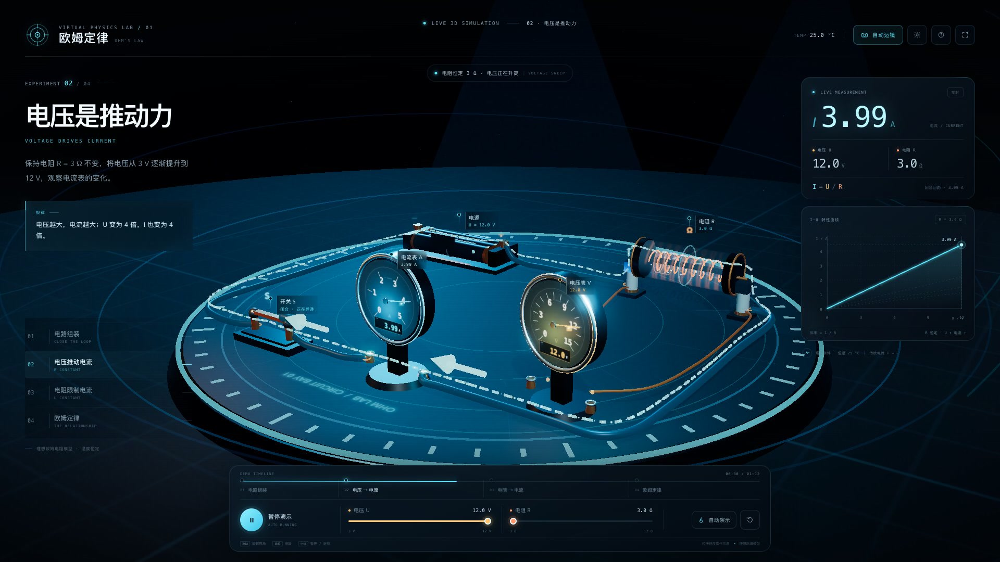
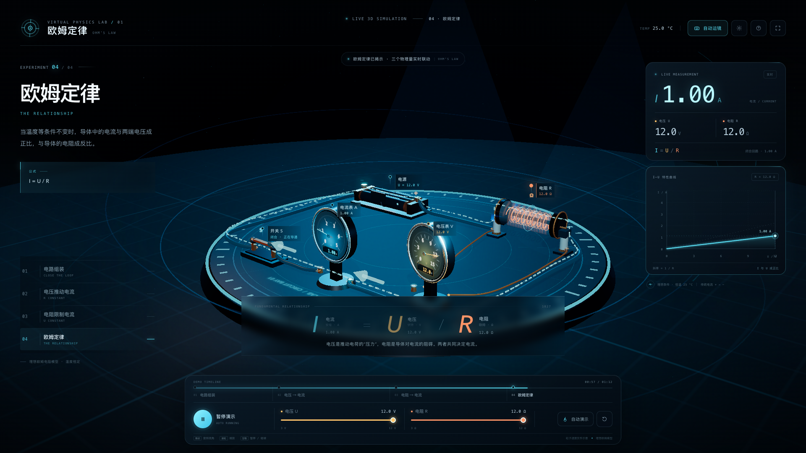
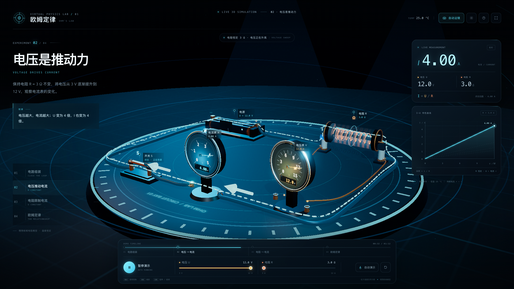
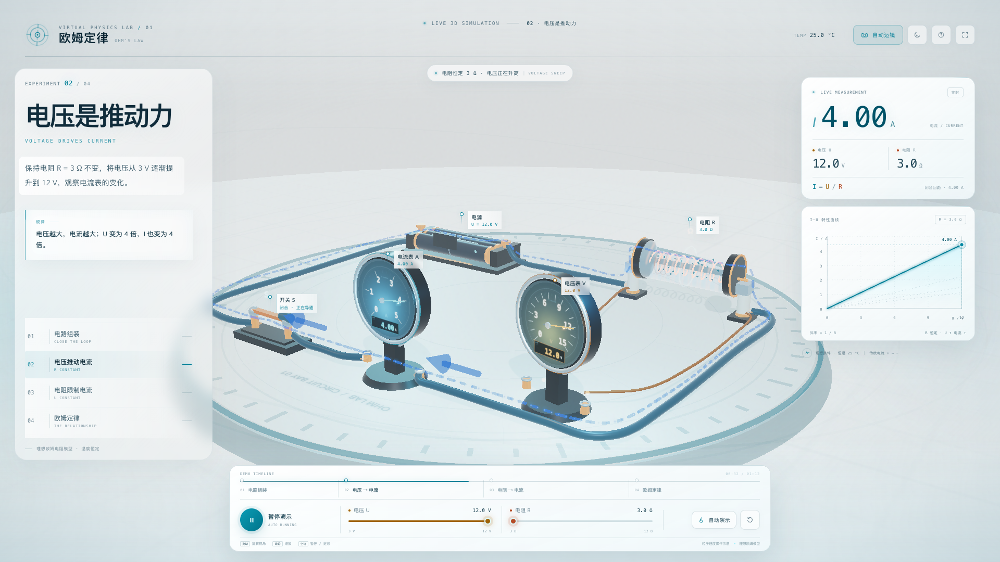
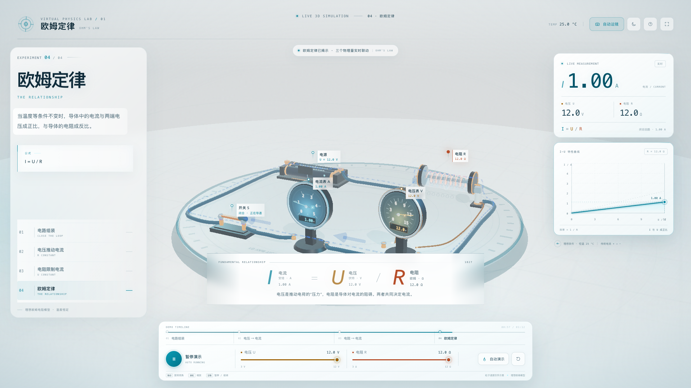
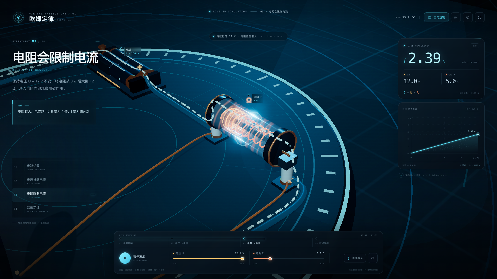

# 欧姆定律 · 3D 交互式物理实验室

面向零基础观众的 Three.js 科教动画实验。四个连续阶段从电路组装讲到欧姆定律，所有模型、灯光、粒子、仪表指针与 I–U 特性曲线均由代码实时生成，不依赖网络素材或构建工具。

## 成片

[**欧姆定律 · 3D 物理实验室 — 1080p MP4**](./video/ohm-law-3d-1080p.mp4)

- 1920 × 1080 · 30 fps · 74 秒 · H.264 · 无音轨
- 完整四阶段自动演示 + 2 秒结论停留 + 首尾淡入淡出



## 预览











## 运行

```bash
cd ohm-law-lab
python3 -m http.server 8137 --bind 127.0.0.1
```

打开 <http://127.0.0.1:8137/>。需要支持 WebGL 2 的现代浏览器（Chrome / Edge / Safari / Firefox）。Three.js r160 与后期处理模块已放在 `vendor/` 内，可完全离线使用。

也可以直接使用 npm 脚本：

```bash
npm run serve   # 启动本地静态服务器
npm run check   # 检查 JavaScript 语法
npm test        # 验证物理模型与自动演示时间轴
```

## 实验流程

1. **接通电路**：电池、导线、开关、电阻、电流表依次出现，电压表并联在电阻两端。开关闭合后，发光电流粒子与拖尾光流沿传统电流方向（电源正极 → 外电路 → 负极）流动，两个箭头同步标出方向。
2. **电压是推动力**：保持 R = 3 Ω，电压从 3 V 升到 12 V，电流从 1 A 升到 4 A。电流光流的速度与密度、电流表指针、表盘数码读数与曲线点同步变化。
3. **电阻会限制电流**：保持 U = 12 V，电阻从 3 Ω 升到 12 Ω，电流从 4 A 降到 1 A。镜头进入电阻内部，螺旋线圈、逐渐增多的阻碍环和内部粒子共同表现电阻对电流的限制。电表同时提供清晰的刻度数字与底部数码读数。
4. **欧姆定律**：镜头拉远，公式 **I = U / R** 逐项高亮，3D 场景同步强调对应的电源/电压表、电流表与电阻；右侧 I–U 特性曲线同步更新。

## 交互

| 操作 | 功能 |
| --- | --- |
| 拖动画面 / 滚轮 | 绕电路旋转 / 缩放 |
| 自动运镜 | 开启或关闭章节镜头运动（拖动画面会自动关闭） |
| 主题按钮 / T | 在深色实验室与浅色实验室之间切换，选择会被记住 |
| 播放 / 暂停 | 暂停或继续自动演示与自由实验 |
| 自动演示 | 从第一阶段重新开始完整 72 秒演示 |
| 重置 | 回到初始状态并重新组装电路 |
| 电压滑杆 U | 3–12 V 连续可调，实时计算电流 |
| 电阻滑杆 R | 3–12 Ω 连续可调，实时计算电流 |
| 阶段列表 / 时间轴 | 跳转到任意实验阶段 |
| 空格 / 1–4 / A / R / T / F | 暂停、跳转、自动演示、重置、切换主题、全屏 |
| 帮助按钮 | 打开完整操作说明 |

## 物理模型

- 采用理想欧姆电阻模型：**I = U / R**。
- 开关断开时回路开路，**I = 0**；闭合后电流表串联在回路中，电压表并联在电阻两端。
- 自动演示中，温度、材料等条件保持不变：
  - R = 3 Ω 恒定，U: 3 → 12 V，则 I: 1 → 4 A；
  - U = 12 V 恒定，R: 3 → 12 Ω，则 I: 4 → 1 A。
- 粒子只用于表现电流的方向与相对大小，**不代表电子真实漂移速度**。粒子速度与亮度仅作示意，不参与任何数值计算。
- 仪表量程：电流表 0–5 A，电压表 0–15 V。

## 技术说明

- 单页静态应用，无构建步骤；ES Module + import map。
- Three.js r160 + `EffectComposer` / `UnrealBloomPass` / `OutputPass`。
- 程序化材质、环境贴图、Canvas 仪表盘纹理与文字贴图；所有几何体均为运行时生成。
- 自动时间轴由 `js/physics.js` 的纯函数驱动，UI、3D 指针、粒子速度与特性曲线共享同一组状态。
- 深色 / 浅色主题同时切换 HUD 配色、Three.js 灯光、环境贴图、平台材质、电流发光与背景网格，主题偏好保存在 `localStorage`。
- 3D 标注用 `Vector3.project()` 投影到 DOM，既保持清晰度又不会随视角糊掉。
- 响应式布局：桌面、短屏笔记本与竖屏移动端均可使用。

## 目录

```text
ohm-law-lab/
├── index.html
├── css/style.css
├── js/
│   ├── physics.js     # 欧姆定律、实验时间轴、特性曲线
│   ├── lab.js         # Three.js 场景、元件、材质、粒子、镜头
│   └── main.js        # 状态机、HUD、交互与同步
├── test/physics.test.mjs
├── vendor/three/      # Three.js r160 + addons（MIT）
└── preview/           # 预览图
```

Three.js 及其 addons 使用 MIT 许可证，见 `vendor/three/LICENSE`。
